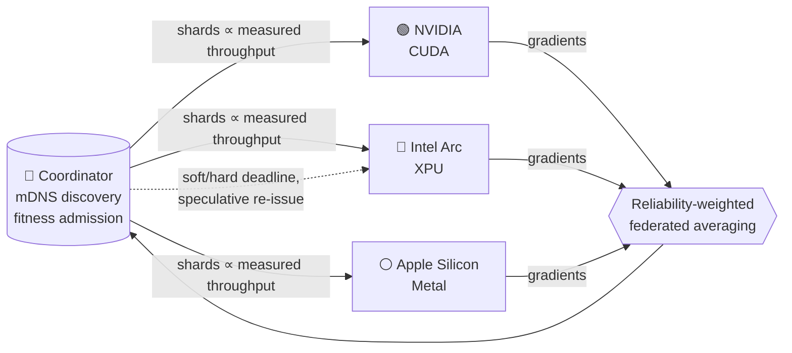

<!-- ============ HEADER ============ -->
<div align="center">


<a href="https://github.com/UJESH2K">
  
</a>

<br/>

<a href="https://ujesh.in"></a>
<a href="https://www.linkedin.com/in/ujesh-kumar-yadav/"></a>
<a href="https://www.instagram.com/ujeshitiz/"></a>
<a href="mailto:ujeshyadav007@gmail.com"></a>


</div>

---

## 🌐 Live: [ujesh.in](https://ujesh.in)

<div align="center">
<a href="https://ujesh.in">
  
</a>
<br/>
<sub>↑ Auto-refreshing screenshot of my site. Click it to explore the real thing.</sub>
</div>

---

## 🧬 Who am I?

```python
class Ujesh:
    role      = "Final-year CSE @ Atria Institute of Technology (VTU), Bengaluru"
    obsession = ["distributed training", "ML systems", "LLM agents", "embodied-AI evals"]
    building  = "GradMesh: one PyTorch model across idle household GPUs"
    shipped   = ["IMPACT-2027 paper", "LitmusChaos CVE patches", "7 hackathon wins"]
    off_duty  = ["state-level football ⚽", "marathons 🏃", "teaching 🎓"]

    def mantra(self):
        return "Measure first. Schedule on reality, not on spec sheets."
```

---

## ⚡ Flagship: GradMesh

> *Can the idle GPUs in a house or lab train one model together over Wi-Fi/LAN?*



| 🔬 Result | 📊 Number |
|---|---|
| Cost model `T(n) = a + bn`, fitted on single-GPU runs only | Predicted all **4 unseen** two-GPU configs within **8%** |
| Two RTX 5070s rated within 4% by a synthetic benchmark | **2.03×** gap in real training throughput |
| Throughput-proportional sharding | Shard-time imbalance **CV 0.319 → 0.107** (3× tighter) |
| v5 per-round overhead (RTX 3050) | **~9 s → under 1 s** |
| Unattended sweep on physical hardware | **18 trials**, limitations reported openly |

📄 **[C1]** *Straggler-Aware Distributed Training on Heterogeneous LAN GPU Clusters via Adaptive Data Sharding*: **IMPACT-2027, accepted. First author.**
📘 **[B1]** *Democratizing AI Compute through Household GPU Meshes over Wi-Fi and LAN*: book chapter, MNNIT Allahabad volume, abstract accepted.
🧪 **[P1]** *Cross-Vendor Heterogeneous GPU Orchestration for Distributed Training*: in prep.

---

## 🏆 Achievements: Level Up

<div align="center">

| 🎖️ | Achievement |
|:-:|---|
| 🥇 | **Winner, Inception World Model Hackathon 2026** (WorldForge) |
| 🥇 | **Winner, DevNova** (Solana track) |
| 🥉 | **Bronze, HackerRank Orchestrate** (rank 410 of 3,000+) |
| 🔥 | **7 hackathon wins · 20+ national finals** (incl. Claude ADHD Hackathon finalist) |
| 🇮🇳 | **Smart India Hackathon 2026: college rank 1** |
| 🌍 | **Google Solution Challenge 2024: regional qualifier** |
| 💻 | **ICPC Asia Regional Preliminaries** (twice) |
| 🛡️ | **LitmusChaos (CNCF):** accepted PRs incl. CVE patches and a K6 log-collection fix |
| 🏫 | **Technical Lead, Code Club** (200+ members) · taught **"50/50"**: 50 lectures in 50 weekdays · organised **five 500+ participant hackathons** |

</div>

### 🌟 Hacktoberfest 2025 Contributor
- Badge ID: `cmgdjgm9u001cjl04ne877t6g`, Earned on Oct 5, 2025

[](https://holopin.io/@ujesh2k)

<div align="center">

</div>

---

## 💼 Experience

<details open>
<summary><b>🧪 GradMesh: Lead Researcher · Atria Institute of Technology</b> <code>May 2026 → now</code></summary>
<br/>

Coordinator–worker training cluster with mDNS discovery, fitness-based admission, throughput-proportional shards, soft/hard deadlines with speculative re-issue, and reliability-weighted federated averaging. v5 spans **CUDA + XPU + Metal**.
</details>

<details>
<summary><b>🏥 EaseMed: ML & Backend Intern</b> <code>Jan – Jun 2026</code> · early team of four</summary>
<br/>

- **Sole engineer** on a disease-outbreak prediction model linking global trade data with WHO and government health APIs to flag hospital inventory risk
- Built LLM + semantic-search services on AWS EC2/S3, a Hugging Face document parser, a real-time WebSocket backend and a serverless ingestion pipeline
- Curated core datasets, researched cross-country medical-supply compliance, joined client meetings in **Dubai and Liverpool** and the fundraising that secured investment
</details>

<details>
<summary><b>🎬 Edactly: Freelance AI Engineer</b> <code>Feb – Apr 2026</code></summary>
<br/>

- RAG pipeline (Python, Manim) that turns a prompt into a syllabus-grounded NCERT explainer video: **3-minute video in ~5 min for ~Rs. 7** on AWS Lambda
- Cleaned and re-labelled a ~5,000-prompt dataset and added ~1,000 new examples
</details>

<details>
<summary><b>🐦 Hitachi × Atria: ML Intern / Student Team Lead</b> <code>2025</code></summary>
<br/>

- Led the team that built a ~600-image bird-species dataset (field capture, Label Studio) and the model pipeline; **Hitachi asked us to keep iterating**
</details>

---

## 🚀 Selected Projects

| Project | What it does | Flex |
|---|---|---|
| 🌍 **WorldForge** | Scores robot policies step by step (approach → grasp → transport → place) against physics predicates, renders runs with world models | 🏆 Winner, Inception World Model Hackathon 2026 |
| 🖐️ **SoloSim** | Checks first-person manipulation video and annotations against what the hands actually do | Auto-passed **68.6%** of segments, kept **97.4%** of correct labels, **4.3× real time** |
| 🌊 **Tidewatch** | Agentic fraud investigation over a TigerGraph graph | **590,742** transactions · **~40 ms**/case · 276 passing tests |
| 👓 **Memory Glasses** | SigLIP scene-change detection → local VLM → Qdrant retrieval | *"Where did I leave my charger?"* |
| 🛒 **Buy or Wait?** | LLM limited to typed amendments from a closed schema | Prompt injection **cannot** change a decision · 🥉 HackerRank Orchestrate |

---

## 🛠️ Arsenal

<div align="center">

<br/>
<br/>


**Also:** `CUDA` · `Intel XPU` · `Apple MPS` · `Hugging Face` · `SigLIP/VLMs` · `Qdrant` · `TigerGraph` · `Label Studio` · `Federated Averaging` · `mDNS/WebSockets` · `LaTeX`

</div>

---

## 📊 Live Stats

<div align="center">


<br/>

<br/>


</div>

### 🐍 The snake is eating my contributions

<div align="center">
<picture>
  <source media="(prefers-color-scheme: dark)" srcset="https://raw.githubusercontent.com/UJESH2K/UJESH2K/output/github-snake-dark.svg"/>
  <source media="(prefers-color-scheme: light)" srcset="https://raw.githubusercontent.com/UJESH2K/UJESH2K/output/github-snake.svg"/>
  
</picture>
</div>

---

## 🎮 Interact with me

<div align="center">

| | |
|---|---|
| 👋 **[Sign my guestbook](https://github.com/UJESH2K/UJESH2K/issues/new?title=%F0%9F%91%8B+Guestbook%3A+%3Cyour+name%3E&body=Where+are+you+from%3F%0AWhat+brought+you+here%3F%0AOne+idea+for+me%3A)** | Open an issue, say hi, and I'll reply |
| 🤝 **[Collaborate on GradMesh](mailto:ujeshyadav007@gmail.com?subject=GradMesh%20collab)** | Got spare GPUs (NVIDIA / Arc / Apple)? Join the mesh |
| 🎓 **[Research chat](mailto:ujeshyadav007@gmail.com?subject=Research%20collaboration)** | ML systems, heterogeneous training, performance modelling |
| ⭐ **Star this profile repo** | Makes the snake happy |

</div>

<div align="center">


*"Two identical GPUs, two completely different speeds. Always measure."*

</div>
