**[C1]** *Straggler-Aware Distributed Training on Heterogeneous LAN GPU Clusters via Adaptive Data Sharding*: IMPACT-2027, accepted, first author.  
**[B1]** *Democratizing AI Compute through Household GPU Meshes over Wi-Fi and LAN*: book chapter, MNNIT Allahabad volume, abstract accepted.  
**[P1]** *Cross-Vendor Heterogeneous GPU Orchestration for Distributed Training*: in preparation.

<table>
<tr>
<td width="50%"> <a href="https://i-nception-2.vercel.app">Live</a> · <a href="https://github.com/UJESH2K/INception-2">Code</a></td>
<td width="50%"> <a href="https://hhgoa.ujesh.in">Live</a> · <a href="https://github.com/UJESH2K/HHGOA">Code</a> · 276 passing tests</td>
</tr>
<tr>
<td width="50%"> <a href="https://www.youtube.com/watch?v=07qBMjPD6m0">Watch</a> · <a href="https://github.com/UJESH2K/crashgraph">Code</a></td>
<td width="50%"> <a href="https://beta.edactly.com/">Visit</a></td>
</tr>
</table>

| More work | What it does | Result |
|---|---|---|
| **SoloSim** | Checks first-person manipulation video and annotations against what the hands actually do | Auto-passed 68.6% of segments, kept 97.4% of correct labels, 4.3× real time |
| **Memory Glasses** | SigLIP scene-change detection, a local VLM and Qdrant retrieval | Answers "Where did I leave my charger?" |
| **Buy or Wait?** | Limits the LLM to typed amendments from a closed schema | Prompt injection can't change a decision. Bronze, HackerRank Orchestrate |
| **NEXR** | Workplace wellbeing, without the stigma | [Visit the site](https://nex-alpha-six.vercel.app/) |

<table>
<tr>
<td width="33%"> <b>Inception</b> · Winner</td>
<td width="33%"> <b>Cypher 1</b> · Winner</td>
<td width="33%"> <b>Denova</b> · Winner, Solana track</td>
</tr>
<tr>
<td width="33%"> <b>Cardano</b> · Winner</td>
<td width="33%"> <b>HackerRank Orchestrate</b> · Bronze, rank 410 of 3,000+</td>
<td width="33%"> <b>Google Solution Challenge</b> · Regional qualifier</td>
</tr>
</table>

Also: Smart India Hackathon 2026 college rank 1 · ICPC Asia Regional Preliminaries twice · Claude ADHD Hackathon finalist · Technical Lead of a 200+ member Code Club · organiser of five 500+ participant hackathons · ["50/50"](https://ujesh.in/#leadership): 50 lectures in 50 weekdays.

<b>GradMesh: Lead Researcher, Atria Institute of Technology</b> · May 2026 to now

 
Coordinator-worker training cluster with mDNS discovery, fitness-based admission, throughput-proportional shards, soft and hard deadlines with speculative re-issue, and reliability-weighted federated averaging. v5 spans CUDA, XPU and Metal.

<b>EaseMed: Full Stack Developer Intern</b> · Jan to Jun 2026

 
Early team of four. Sole engineer on a disease-outbreak prediction model linking global trade data with WHO and government health APIs to flag hospital inventory risk. Built LLM and semantic-search services on AWS, a Hugging Face document parser, a real-time WebSocket backend and a serverless ingestion pipeline. Also joined client meetings in Dubai and Liverpool and the fundraising that secured investment.

<b>Edactly: Freelance AI Engineer</b> · Feb to Apr 2026

 
Built a RAG and Manim pipeline that turns a prompt into a syllabus-grounded NCERT video: 3 minutes of video in about 5 minutes for about ₹7 on AWS Lambda. Cleaned and re-labelled a ~5,000-prompt dataset and added ~1,000 new examples.

<b>Hitachi × Atria: ML Intern and Student Team Lead</b> · 2025

 
Led the team that built a ~600-image bird-species dataset and the model pipeline. Hitachi asked us to keep iterating.

<b>LitmusChaos (CNCF): Open-source contributor</b> · Oct 2025

 
Seven accepted pull requests in Go during Hacktoberfest 2025. <a href="https://holopin.io/@ujesh2k">See my badges</a>.

<b>Got spare GPUs?</b> <a href="mailto:ujeshyadav20k5@gmail.com?subject=GradMesh%20collab">Join the GradMesh mesh</a> · <a href="mailto:ujeshyadav20k5@gmail.com?subject=Research%20collaboration">Talk research</a> · <a href="https://github.com/UJESH2K/UJESH2K/issues/new?title=Guestbook">Sign my guestbook</a>

<picture>
  <source media="(prefers-color-scheme: dark)" srcset="https://raw.githubusercontent.com/UJESH2K/UJESH2K/output/github-snake-dark.svg"/>
  <source media="(prefers-color-scheme: light)" srcset="https://raw.githubusercontent.com/UJESH2K/UJESH2K/output/github-snake.svg"/>
  
</picture>

Robot: <a href="https://sketchfab.com/3d-models/robot-playground-59fc99d8dcb146f3a6c16dbbcc4680da">"Robot Playground"</a> by Hadrien59, <a href="http://creativecommons.org/licenses/by/4.0/">CC BY 4.0</a>. Rendered as an animated sprite.

